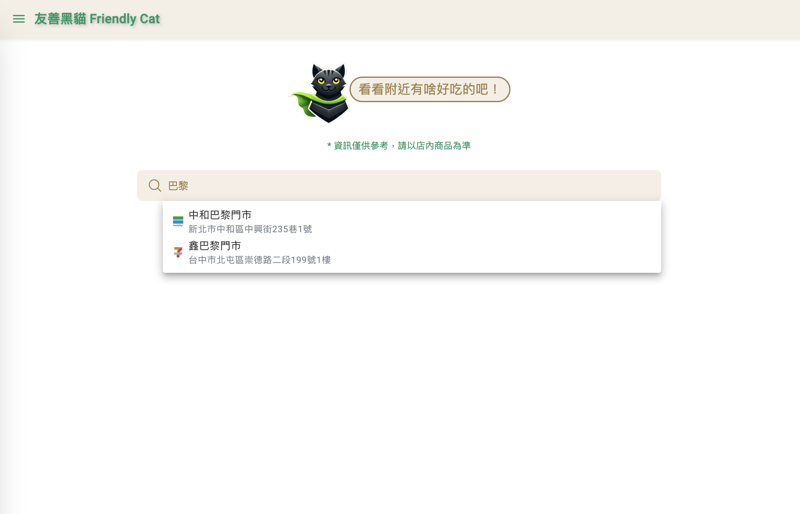
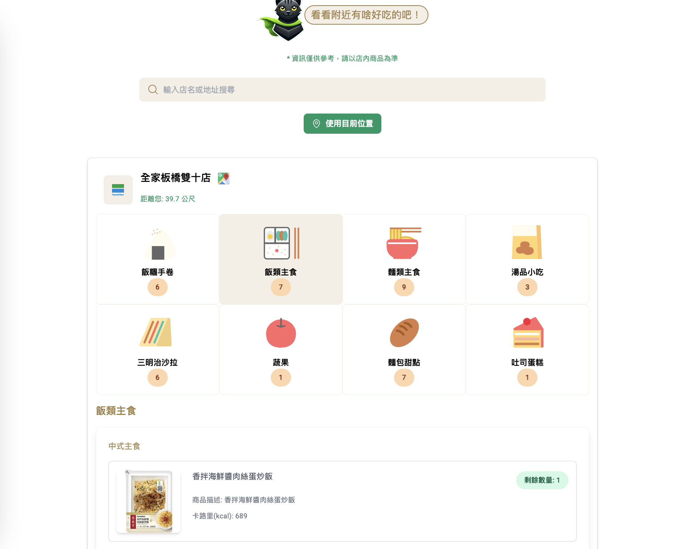
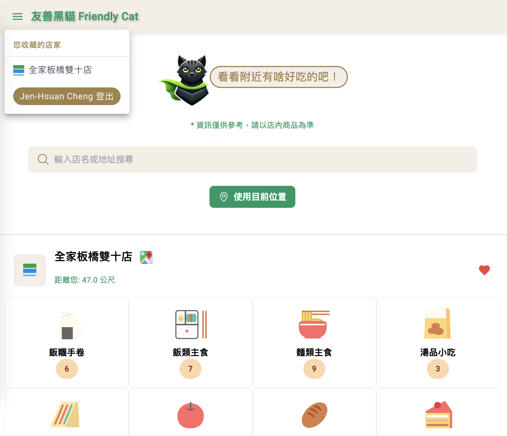
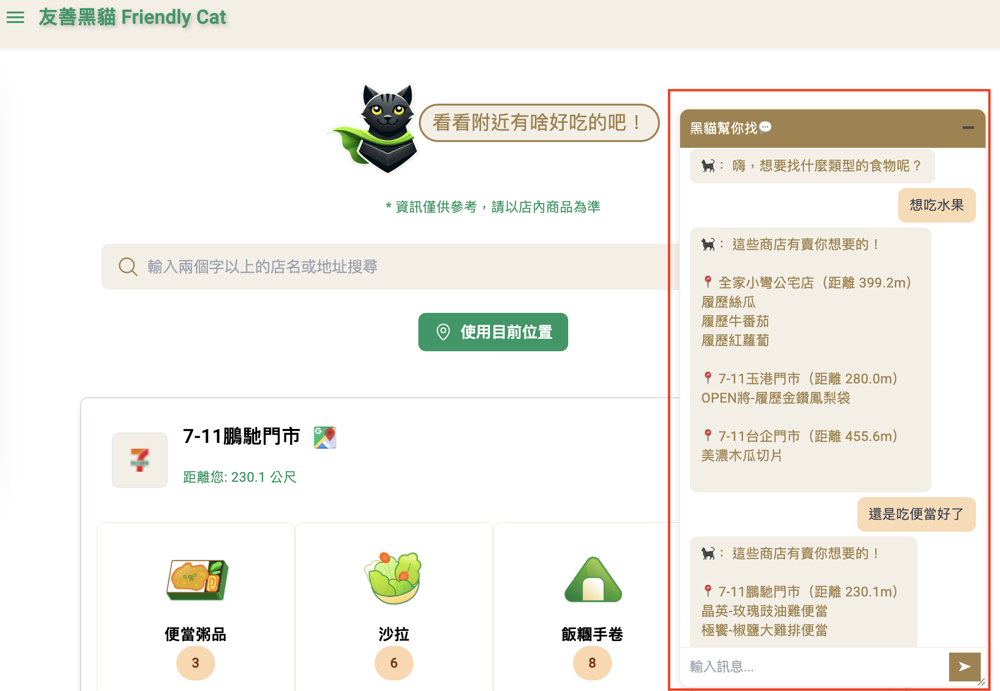

# 友善黑貓 FriendlyCat App

### 功能

* 2025/12：店家搜尋新增「同音搜尋」，例如： 辛巴裡 -> 可以搜尋到 鑫巴黎 便利商店

* 2025/03：新增聊天機器人功能，可使用對話搜尋食物

* 查詢所在位置附近便利商店的即期商品

* 以店家名稱、地址查詢特定店家即期商品

* 全家便利商店(FamilyMart)顯示：
    1. 商品圖片
    2. 商品資訊
* 7-11(Seven-Eleven)顯示：
    1. 商品圖片
    2. 商品價格
    3. 商品資訊
* 會員功能 - 收藏喜愛的商店

## 3D 街區地圖

首頁以 MapLibre + OpenFreeMap 的滿版 3D 街區為主畫面，不需要地圖 API Key。建築以真實輪廓和示意高度呈現，商家與黑貓由 Three.js 建模。進站自動執行既有 Cloudflare Turnstile 驗證，驗證與場景就緒後自動進入；驗證失敗可重試，需人工確認時保留官方提示。

- 進站驗證與街區準備分別顯示 spinner，完成後切換勾選。進入世界後請求定位，授權後顯示黑貓並追蹤座標；附近庫存也同步供側邊欄食物搜尋使用，不需先手動查門市。未授權時預設瀏覽台北街區。
- 搜尋與商品內容以原生視窗開啟，Esc 關閉後回到世界；會員與收藏透過左上角的街區手帳開啟。首次進站提供 Driver.js 導引，完成或略過後會記住狀態，手帳內可重新開啟。
- 點擊地圖店家或店家清單，直接開啟該門市的商品視窗；以分類切換與分隔線商品列表呈現，右上角重新整理、右下角保留庫存提醒。店家清單同步顯示庫存件數。
- 7-ELEVEN 標籤顯示 `SevenEleven n 件`，件數直接取門市 `RemainingQty`；點店後用同一份明細快照更新彈窗與標籤，較早發出的請求不會覆蓋較新的單店資料。
- 滑過店家清單時，對應 3D 店家會發亮並放大；物件本身 hover 不會發亮。標籤依屋頂投影定位，黑貓與店家隨地圖拉遠自然縮小。
- 支援品牌篩選、2D／3D 切換與鍵盤操作；每個視野最多顯示最近 60 間商家。
- 地圖失敗時保留商家清單。定位需 HTTPS 或 localhost，未定位不顯示黑貓或使用者距離。
- 底圖保留 OpenMapTiles／OpenStreetMap 來源標示；服務政策見 [OpenFreeMap](https://openfreemap.org/)。庫存仍依賴既有商家 API 與瀏覽器驗證。
- 地圖與 Three.js 分開延遲載入；全家目錄可由本機 assets 備援，7-ELEVEN 沿用既有遠端目錄。

執行地圖與驗證測試：`npm test -- --watch=false --browsers=ChromeHeadless --include=src/app/search-food/store-map/store-map.component.spec.ts --include=src/app/services/proxy-token.service.spec.ts`。

## DEMO
#### 連結： [友善黑貓](https://friendlycat.alan-cheng.com/)
>
>
>
>### 1. 搜尋功能
>
> * 關鍵字彈出可選店家，點擊店家顯示該店家搜尋結果
>
> * 點選「使用目前位置」則以目前為中心搜尋附近店家，並顯示距離
>
>
>
>
>### 2. 商品列表
>
> - 點選食物分類，顯示該分類下各商品詳細資訊
>
>
>
>
>### 3. 會員功能
>
> - 加入會員後可由導覽列登入，商店右方愛心可將該店加入收藏
>
>
>
>
>### 4. 聊天機器人功能
>
> - 可使用聊天機器人，自動搜尋想找的食物資訊
>
>

## 技術工具

>| 技術  | 版本 |
>| ------------- |:-------------:|
>| Angular       | ^14.2.0      |
>| Node.js       | 18.20.4      |
>| TypeScript    | ~4.7.2       |
>| Tailwindcss   | ^2.2.19      |
>| Python        | 3.12.4       |
>| Firebase Authentication      | --           |
>| Firebase Storage        | --       |
>| Cloudflare Worker        | --       |
>| Chatbot(OpenRouter-DeepSeek V3)      | --       |

---

> ## 執行開發伺服器
>>
>使用指令`ng serve` 啟動於`http://localhost:4200/`，偵測到更新時會自動刷新畫面。

> ## Local Build 指令
>
>- 輸出靜態資源於/docs，加上專案名稱前綴為GitHub-Pages存取路徑：
>
>`ng build --configuration=production --base-href /Friendly-Cat/ --output-path=docs --aot`
>
>- 輸出於專案根目錄之/dict/<專案名稱>：
>
>`ng build --configuration=production --aot`
>

> ## iOS APP Build指令
>
>
> - 輸出靜態資源於專案根目錄之/dist：
>
>`ng build --configuration=production --output-path=dist --aot`
>
> - 將更新後的打包檔案同步至iOS專案資料夾：
>
>`npx cap sync ios`
>
> - 開啟Xcode：
>
>`npx cap open ios`
>

> ## 部署
>
> - **GitHub Pages**: 自動部署到 `https://alan-cheng.github.io/Friendly-Cat/`
> - **Cloudflare Pages**: 自動部署到 `https://friendlycat.alan-cheng.com/`
