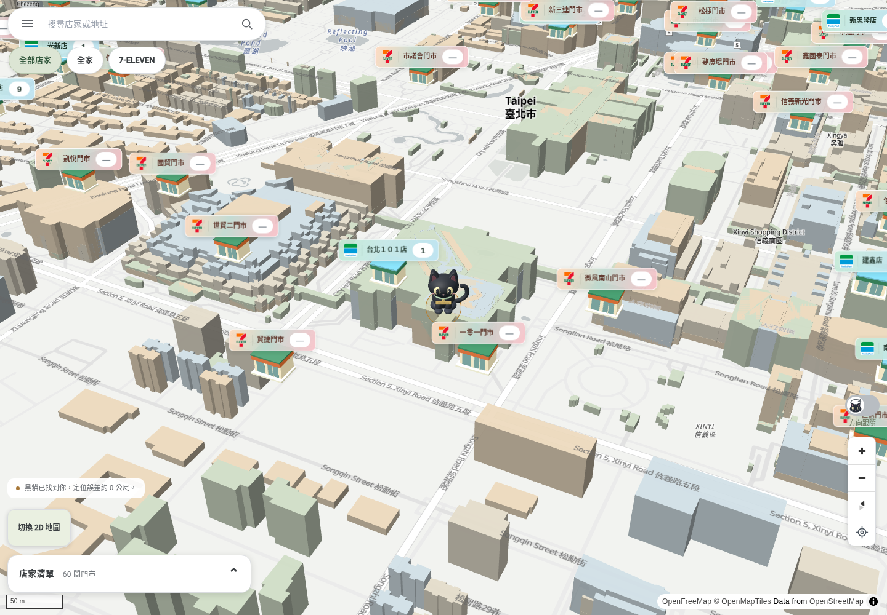
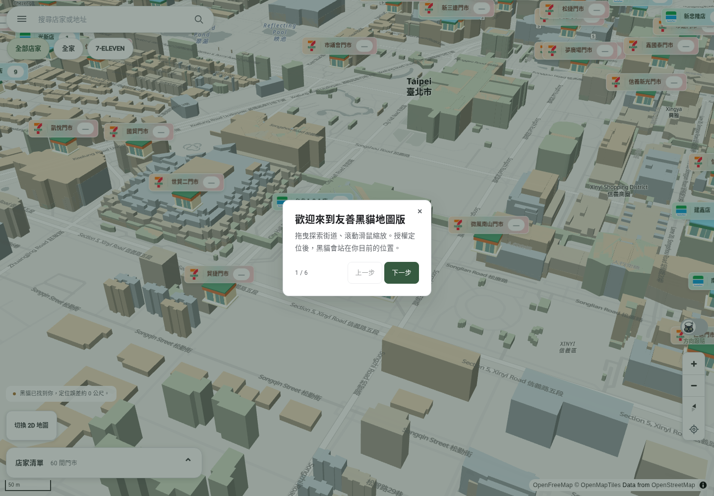
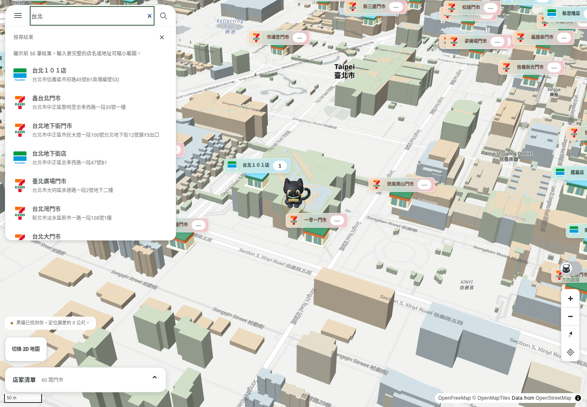
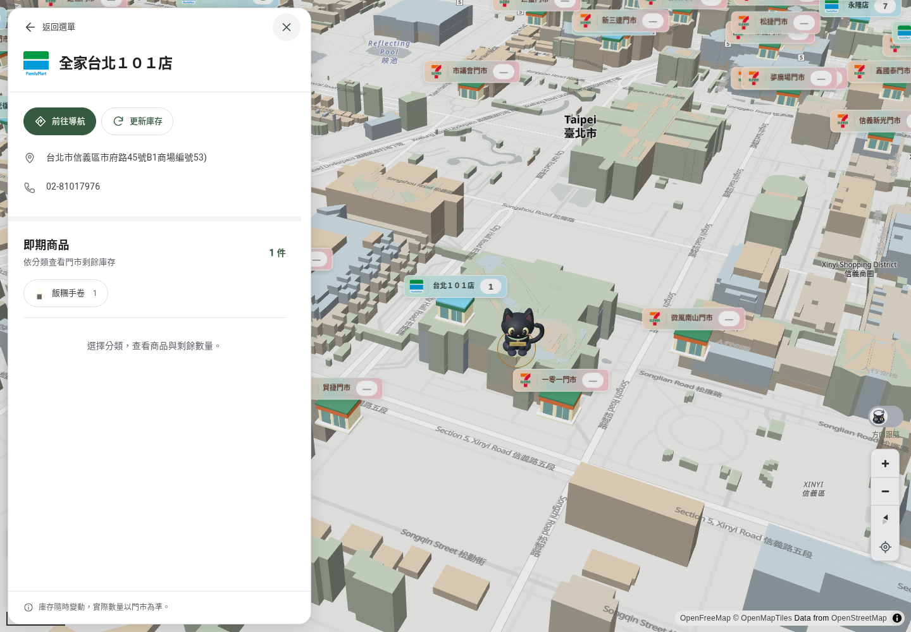
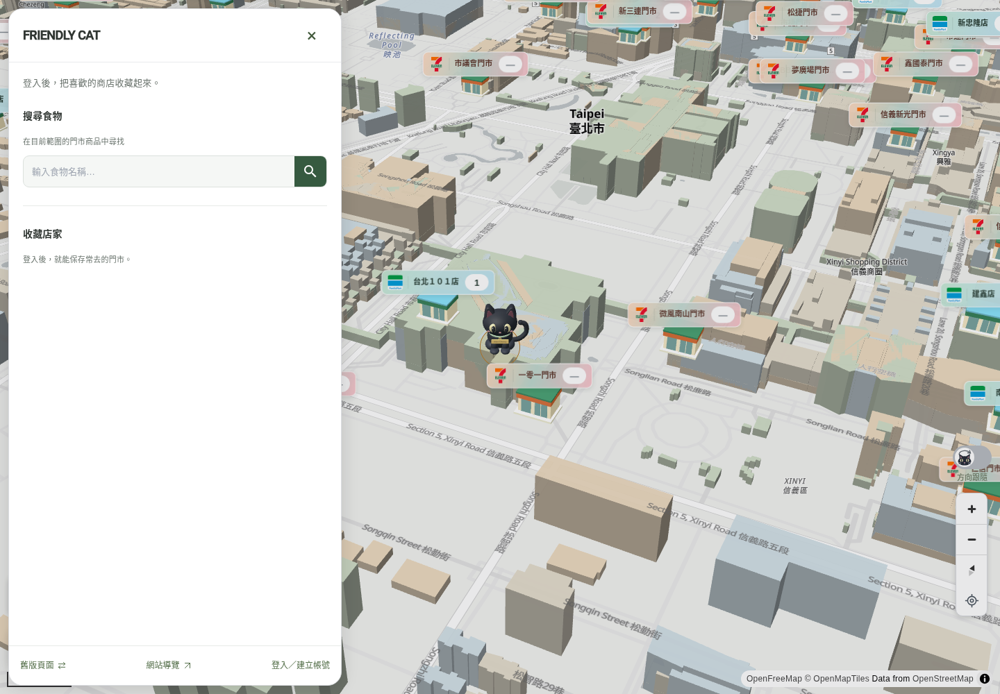
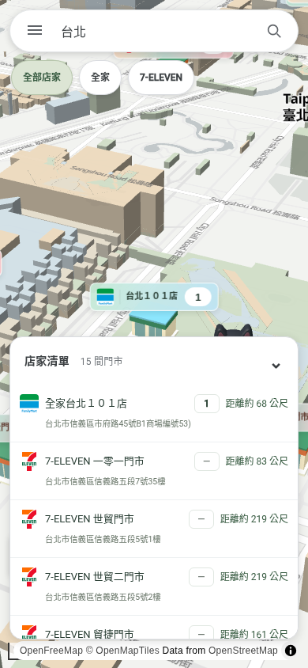

# 友善黑貓 FriendlyCat App

### 功能

* 2025/12：店家搜尋新增「同音搜尋」，例如： 辛巴裡 -> 可以搜尋到 鑫巴黎 便利商店

* 查詢所在位置附近便利商店的即期商品

* 以店家名稱、地址查詢特定店家即期商品

* 全家便利商店(FamilyMart)顯示：
    1. 商品圖片
    2. 商品資訊
    3. 原價與固定 7 折價格（查得到價格時顯示，舊版與新版皆支援）
* 7-11(Seven-Eleven)顯示：
    1. 商品圖片
    2. 商品價格
    3. 商品資訊
* 會員功能 - 收藏喜愛的商店

## DEMO

#### 連結：[友善黑貓](https://friendlycat.app/)

### 1. 地圖與附近店家

- 拖曳地圖探索附近店家，可篩選全家、7-ELEVEN，或切換 2D／3D 視角。
- 允許定位後，黑貓會出現在目前位置；點選店家即可查看即期商品。

### 2. 首次操作導覽

- 首次進站會介紹地圖操作與主要功能，也可從會員與收藏選單的「網站導覽」重新開啟。

### 3. 搜尋功能

- 輸入店名或地址選擇店家，支援同音搜尋。
- 選取搜尋結果後，地圖會移動到該門市；右下角定位按鈕可查看目前位置附近的店家。

### 4. 商品列表

- 點選地圖上的店家或店家清單，從側邊面板查看門市資訊與即期商品。
- 選擇商品分類查看庫存，也可點選「更新庫存」或「前往導航」。

### 5. 會員選單與收藏

- 點選左上角選單，可搜尋目前地圖範圍的門市商品。
- 登入會員後，可收藏喜愛的商店並從選單查看。

### 6. 手機版地圖

- 手機上也能搜尋門市、切換地圖視角，並展開下方的店家清單。

## 指定門市連結

- URL 參數支援
    - ?brand=seven&store=<店號>&map=true：開啟 7-ELEVEN 地圖版。
    - ?brand=family&store=<店號>&map=false：開啟全家舊版。
    - map 預設為 true(地圖版)
    - 只要帶有 store，就必須明確指定單一 brand=seven 或 brand=family。

## 技術工具

套件版本範圍依 `package.json`，執行環境依 GitHub Actions 設定。

| 技術 | 版本 | 用途 |
| --- | --- | --- |
| Angular | ^18.2.13 | 前端框架 |
| Angular Material / CDK | ^18.2.14 | 介面元件 |
| TypeScript | ^5.5.0 | 前端開發 |
| Tailwind CSS | ^2.2.19 | 樣式工具 |
| RxJS | ~7.8.0 | 非同步資料流 |
| MapLibre GL JS | ^5.24.1 | 互動地圖 |
| Three.js | ^0.170.0 | 3D 店家與黑貓模型 |
| OpenFreeMap | — | 地圖底圖 |
| Driver.js | ^1.12.1 | 操作導覽 |
| Fuse.js / pinyin-pro | ^7.0.0 / ^3.27.0 | 模糊與同音搜尋 |
| Firebase / AngularFire | ^11.1.0 / ^18.0.1 | 會員驗證、Firestore 收藏與 Realtime Database |
| Cloudflare Workers / KV / Turnstile | — | 7-ELEVEN API 代理與瀏覽器驗證 |
| Node.js | 18（CI） | 前端建置 |
| Python | 3.12（CI） | 門市與商品資料爬蟲 |
| GitHub Actions / GitHub Pages / Cloudflare Pages | — | 自動更新、建置與部署 |

---

> ## 執行開發伺服器
>>
>使用指令`ng serve` 啟動於`http://localhost:4200/`，偵測到更新時會自動刷新畫面。

> ## Local Build 指令
>
>- 輸出靜態資源於/docs，加上專案名稱前綴為GitHub-Pages存取路徑：
>
>`ng build --configuration=production --base-href /Friendly-Cat/ --output-path=docs --aot`
>
>- 輸出於專案根目錄之/dict/<專案名稱>：
>
>`ng build --configuration=production --aot`
>

> ## iOS APP Build指令
>
>
> - 輸出靜態資源於專案根目錄之/dist：
>
>`ng build --configuration=production --output-path=dist --aot`
>
> - 將更新後的打包檔案同步至iOS專案資料夾：
>
>`npx cap sync ios`
>
> - 開啟Xcode：
>
>`npx cap open ios`
>

> ## 部署
>
> - **GitHub Pages**: 自動部署到 `https://alan-cheng.github.io/Friendly-Cat/`
> - **Cloudflare Pages**: 自動部署到 `https://friendlycat.app/`
